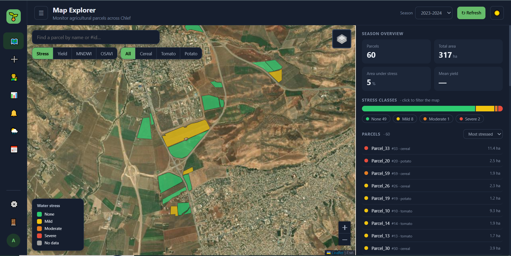
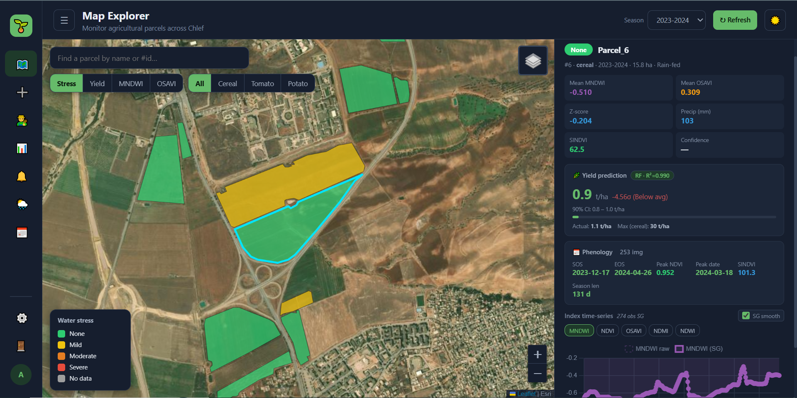
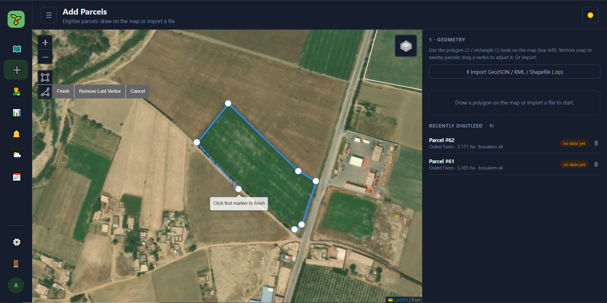
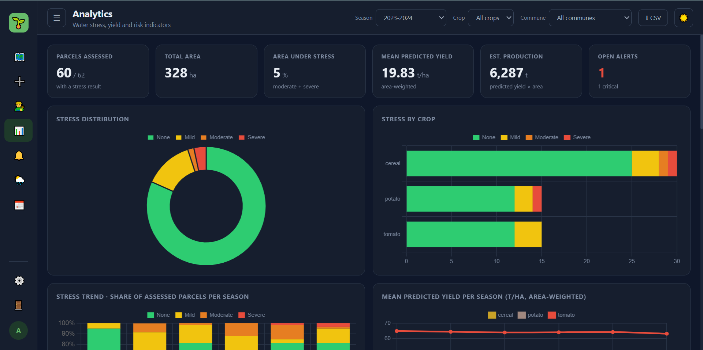
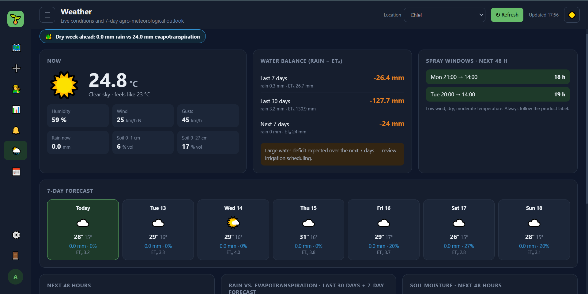
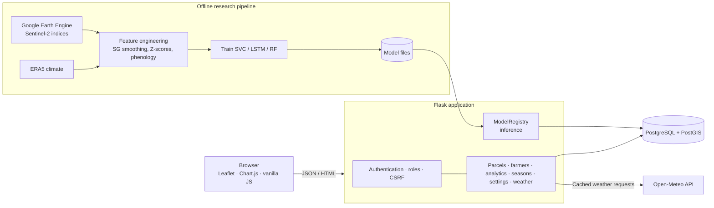

# 🌱 AgroVisionDZ — Satellite-Based Water-Stress Monitoring & Yield Forecasting for Chlef, Algeria

AgroVisionDZ is a web GIS project that combines **Sentinel-2 vegetation and water indices** with **ERA5 climate data** to assess parcel-level water stress and explore crop-yield forecasting for agricultural monitoring in Chlef, Algeria.

The project began as a Master's thesis in AI/ML and was extended into a multi-user application concept for field workers, supervisors, and ministry staff.

> **Portfolio repository:** This repository presents the project, its architecture, selected screenshots, and research results. It does not contain the application's source code, trained model files, credentials, or private datasets.

## Application screenshots

Add your screenshots to `docs/img/` using the filenames below. Until you add them, GitHub will show broken image placeholders for these entries; you can remove any image line for a screenshot you do not want to publish.

## What it does

| Area                          | Highlights                                                                                                                                                                                                                                                                      |
| ----------------------------- | ------------------------------------------------------------------------------------------------------------------------------------------------------------------------------------------------------------------------------------------------------------------------------- |
| **Map Explorer**              | Parcel layer coloured by stress class (none to severe), yield, MNDWI, or OSAVI. Parcel details include yield predictions with a 90% interval, phenology metrics (SOS / EOS / peak NDVI), and Savitzky–Golay-smoothed index time series.                                         |
| **Add Parcels**               | Polygon drawing with vertex snapping (Leaflet-Geoman) and import support for GeoJSON, KML, or zipped Shapefiles. The application design uses server-side PostGIS validation for geometry, area limits, wilaya containment, automatic commune assignment, and overlap detection. |
| **Farmers**                   | Searchable registry linked to parcels.                                                                                                                                                                                                                                          |
| **Analytics**                 | Season KPIs, stress trends, commune ranking, high-risk parcels, predicted-versus-actual yield, monthly climate, and CSV export.                                                                                                                                                 |
| **Weather**                   | Current conditions and a 7-day outlook from Open-Meteo, FAO-56 reference evapotranspiration (ET₀), and frost / heat / heavy-rain / wind warnings.                                                                                                                               |
| **Alerts**                    | Water-stress and weather-risk notifications, alert status tracking, and alert-monitoring workflows for supervisors.                                                                                                                                                             |
| **Seasons**                   | Data-coverage overview per season and crop-record management.                                                                                                                                                                                                                   |
| **Settings & administration** | Role management, wilaya scoping, user administration, temporary passwords, audit logging, and session revocation.                                                                                                                                                               |

## Machine-learning results — with limitations

The research dataset covers **60 digitized parcels across 6 growing seasons (2018–19 to 2023–24)** and three crop groups: cereals, tomato, and potato. Features were derived from Sentinel-2 (NDVI, NDWI, MNDWI, OSAVI, and NDMI, using Google Earth Engine at 10 m) and ERA5 monthly climate data. Labels were based on DSA yield statistics.

| Task                                   | Model          | Reported result                                                                                                       |
| -------------------------------------- | -------------- | --------------------------------------------------------------------------------------------------------------------- |
| Four-class water-stress classification | SVC            | Macro-F1: **0.645** (cross-validation) / **0.576** (held-out test)                                                    |
| Stress sequence modelling              | LSTM           | Cohen's κ: **0.654**                                                                                                  |
| Yield regression                       | Random Forest  | R²: **0.97–0.99** globally; largely explained by differences between crops (tomato ≈ 60 t/ha versus cereals ≈ 2 t/ha) |
| Within-crop yield anomaly              | Several models | **Negative R²**; no predictive skill beyond the crop mean                                                             |

Key observations:

- **MNDWI was the dominant feature**, accounting for approximately 47% of SHAP importance in the reported analysis.
- The dataset is small (60 parcels), so results are indicative and **not suitable for operational decision-making without further validation**.
- Global yield-regression scores are strongly influenced by between-crop differences; they should not be interpreted as evidence of reliable within-crop yield-anomaly prediction.

## Architecture

## Design decisions

- **Spatial validation on the server:** parcel geometry validation, area calculation, and commune assignment are handled server-side with PostGIS rather than relying on browser-only checks.
- **Separation of concerns:** reusable application logic is organised into service modules, with unit tests for areas such as weather indicators, analytics metrics, password policy, and user-management rules.
- **Security controls:** the application design includes authenticated sessions, CSRF protection for mutating requests, role and wilaya scoping, safe redirects, HTML escaping, CSV formula-injection protection, audit logging, and session revocation.

## Technologies

- **Remote sensing and climate:** Sentinel-2, Google Earth Engine, ERA5
- **Machine learning:** scikit-learn (SVC, Random Forest), LSTM, SHAP
- **Backend and database:** Python, Flask, PostgreSQL, PostGIS
- **Frontend and mapping:** Leaflet, Leaflet-Geoman, Chart.js, JavaScript
- **Weather:** Open-Meteo and FAO-56 ET₀ indicators

## Data, models, and licences

- No real farmer, parcel, or yield data is published in this portfolio. Use only screenshots with synthetic or otherwise approved demo data.
- Trained model files and raw satellite exports are not included.
- Weather data: [Open-Meteo](https://open-meteo.com/) (check the provider's current licence and terms for your intended use).
- Administrative boundaries: [GADM](https://gadm.org/) has usage and redistribution restrictions; boundary data is not included here.
- Basemap sources may include Esri World Imagery and OpenStreetMap contributors, subject to their respective terms.
- The application's source repository is kept private and is not part of this portfolio repository.

## Limitations and future work

- The study covers 60 parcels and 6 seasons; the models are research-grade, not operational.
- Within-crop yield anomaly prediction was not reliable with the current features and sample size.
- Potential next steps include adding more parcels and seasons, improving independent validation, preparing reproducible data/model documentation, and adding scheduled inference and demo-data seeding.

## Author

**Ouffa Mohammed Said**  
AI/ML Master's graduate — Hassiba Benbouali University of Chlef  
Email: [ouffamohammedsaid8@gmail.com](mailto:ouffamohammedsaid8@gmail.com)
